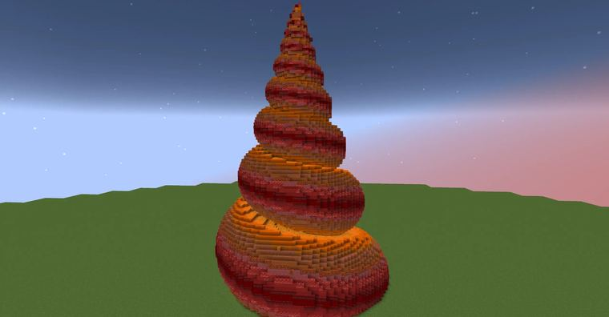

# 螺

> 作者：**imhols**（UID 632698683） · 2023年6月23日 · 类型：`DYNAMIC_TYPE_DRAW` · [原动态](https://www.bilibili.com/opus/810085537041874947)

**WorldEdit / 程序化建模相关**

## 动态内容

螺

//calc 
n=1000;d=0.1;
a=20;b=6;
for(i=0,255)for(j=0;jn*3)break;
t=k/3*d;
r=e^(-t/a);
gmegabuf(k,r*cos(t));
gmegabuf(k+1,1-r*b);
gmegabuf(k+2,r*sin(t))
}1

n是点的个数，d是步长
a控制旋转程度，b控制斜率

//g 251 
n=1000;i=gclosest(x,y,z,0,n,3);a=gmegabuf(i)b=gmegabuf(i+1)c=gmegabuf(i+2);
r=(x-a)^2+(y-b)^2+(z-c)^2;
R=a^2+c^2;
data=abs(y-b)/sqrt(r)*16%16;
r<R


## 图片



## 指令

```text
//calc
//g 251
```

---

内容与图片版权归 **imhols** 所有；本页为作品集索引。
