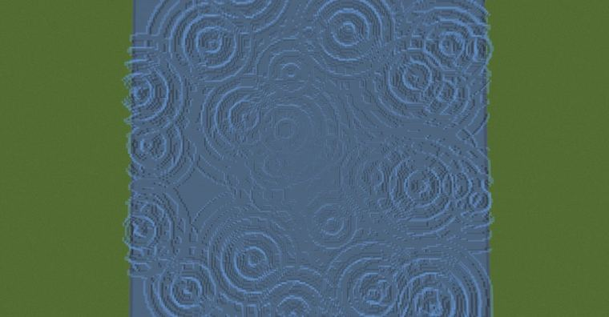

# 涟漪

> 作者：**imhols**（UID 632698683） · 2023年7月3日 · 类型：`DYNAMIC_TYPE_DRAW` · [原动态](https://www.bilibili.com/opus/814126706377883682)

**WorldEdit / 程序化建模相关**

## 动态内容

涟漪

//calc n=1000;for(i=0,255)for(j=0;jn*3)break;gmegabuf(k,2*random()-1);gmegabuf(k+1,0);gmegabuf(k+2,2*random()-1)}1 

//g 251 
n=50;f=0;
for(i=0,255)for(j=0;jn*3)break;
X=gmegabuf(k);
Z=gmegabuf(k+2);
r=sqrt((x-X)^2+(z-Z)^2);
f=max(f,max((0.1*(k/3%6)-r),0)*(sin(80*r+k)+1))
}
data=f*16%16;
y+1<2*f


## 图片




## 指令

```text
//calc n=1000;for(i=0,255)for(j=0;jn*3)break;gmegabuf(k,2*random()-1);gmegabuf(k+1,0);gmegabuf(k+2,2*random()-1)}1
//g 251
```

---

内容与图片版权归 **imhols** 所有；本页为作品集索引。
