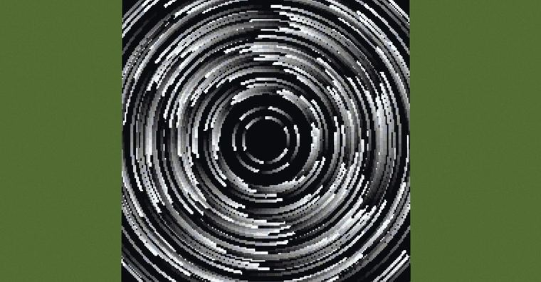
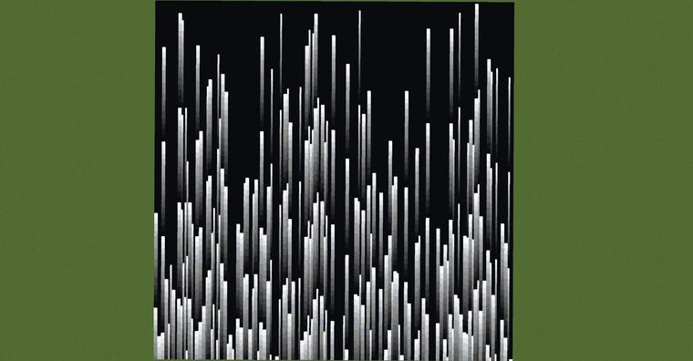
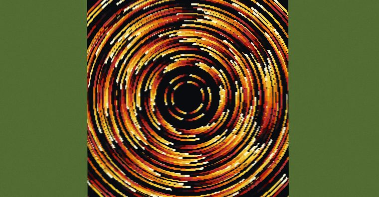
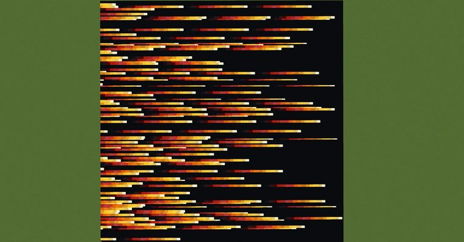

# 星轨

> 作者：**imhols**（UID 632698683） · 2023年7月21日 · 类型：`DYNAMIC_TYPE_DRAW` · [原动态](https://www.bilibili.com/opus/820476042191831107)

**WorldEdit / 程序化建模相关**

## 动态内容

星轨

1.撒星星
//calc n=1000;for(i=0,255)for(j=0;jn*3)break;gmegabuf(k,2*random()-1);gmegabuf(k+1,0);gmegabuf(k+2,2*random()-1)}1 

2.1轴向
//g 251 n=100;for(i=0,255)for(j=0;jn*3)break;
X=gmegabuf(k);Z=gmegabuf(k+2)
if(abs(z-Z)n*3)break;
X=gmegabuf(k);Z=gmegabuf(k+2)
r=sqrt(x^2+z^2);R=sqrt(X^2+Z^2);
t=atan2(x,z);T=atan2(X,Z);
if(t>T){T+=2*pi}
if(abs(r-R)<0.01&&(r=T-t)){data=r*16%16;return r}};0


## 图片









## 指令

```text
//calc n=1000;for(i=0,255)for(j=0;jn*3)break;gmegabuf(k,2*random()-1);gmegabuf(k+1,0);gmegabuf(k+2,2*random()-1)}1
//g 251 n=100;for(i=0,255)for(j=0;jn*3)break;
```

---

内容与图片版权归 **imhols** 所有；本页为作品集索引。
