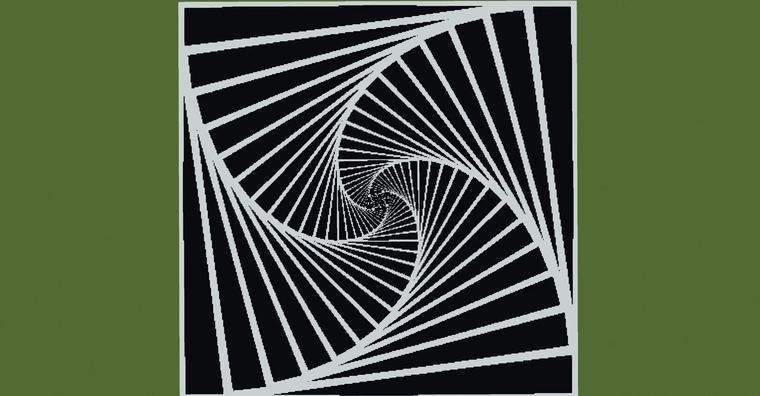
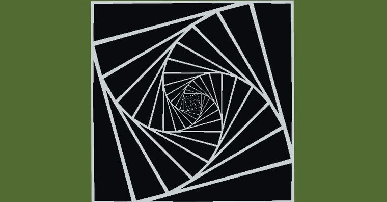
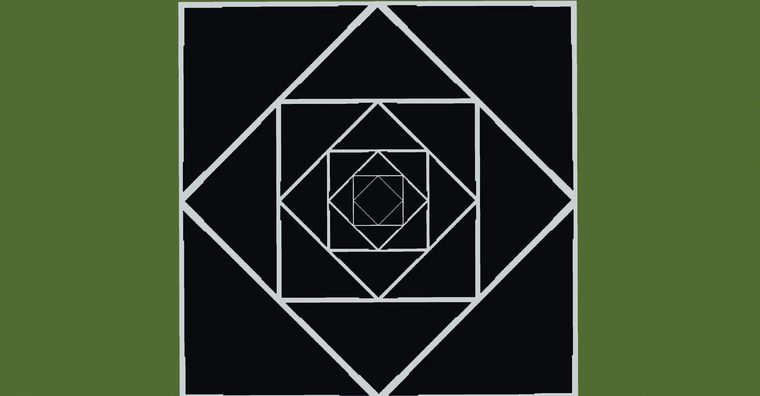
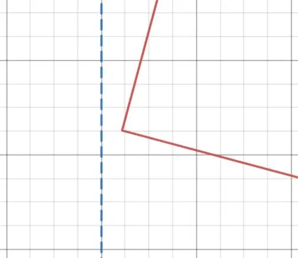

# 向内同心旋转的螺旋正方形

> 作者：**imhols**（UID 632698683） · 2023年8月18日 · 类型：`DYNAMIC_TYPE_DRAW` · [原动态](https://www.bilibili.com/opus/831138990235058197)

**WorldEdit / 程序化建模相关**

## 动态内容

向内同心旋转的螺旋正方形

//generate 251 k=24;for(i=0,2*k){if(abs(max(abs(x),abs(z))-k^(-i/k))<0.02*sqrt(x^2+z^2)){return 1}rotate(x,z,pi/k);}0 

k代表每次旋转角度为pi/k，下图k分别为24，12，4

https://www.desmos.com/calculator/8t0p4wp3ps
（找规律的途中找到了这样一个通式，一眼看上去很完美，放大看居然还有一段距离）


## 图片









## 指令

```text
//generate 251 k=24;for(i=0,2*k){if(abs(max(abs(x),abs(z))-k^(-i/k))<0.02*sqrt(x^2+z^2)){return 1}rotate(x,z,pi/k);}0
```

---

内容与图片版权归 **imhols** 所有；本页为作品集索引。
