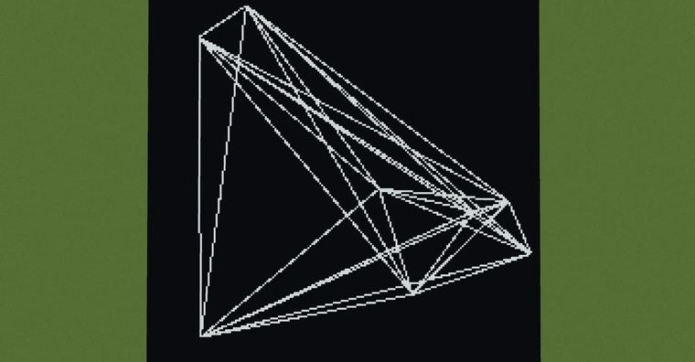
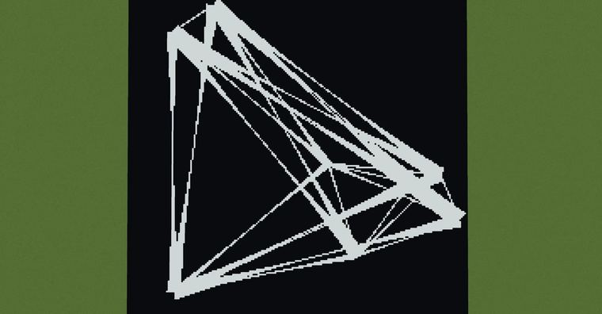
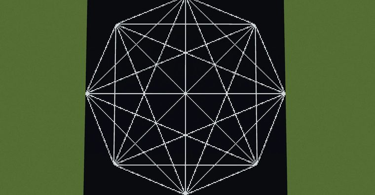
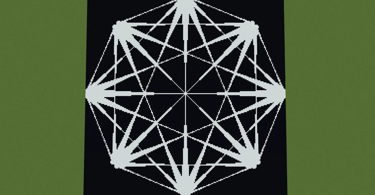

# 两两连接所有点

> 作者：**imhols**（UID 632698683） · 2023年9月16日 · 类型：`DYNAMIC_TYPE_DRAW` · [原动态](https://www.bilibili.com/opus/841959129288278081)

**WorldEdit / 程序化建模相关**

## 动态内容

两两连接所有点

1、生成点
随机
//calc n=1000;for(i=0,255)for(j=0;jn*3)break;gmegabuf(k,2*random()-1);gmegabuf(k+1,0);gmegabuf(k+2,2*random()-1)}1
正多边形顶点
//calc n=8;t=2*pi/n;for(i=0;i<(n+1)*3;i+=3){X=cos(t*i/3);Z=-sin(t*i/3);gmegabuf(i,X);gmegabuf(i+1,0);gmegabuf(i+2,Z)} 

2、连线
直的
//g 251 n=8for(i=0;i<3*n;i+=3)for(j=0;j<3*n;j+=3){a=gmegabuf(i)b=gmegabuf(i+2)c=gmegabuf(j)d=gmegabuf(j+2)t=atan2(b-d,a-c)r=sqrt((a-c)^2+(b-d)^2)X=x-(a+c)/2Z=z-(b+d)/2if(max(abs(X*sin(t)-Z*cos(t))*r/.01,abs(X*cos(t)+Z*sin(t)))<r/2)return 1}0 
拉丝的
//g 251 n=8for(i=0;i<3*n;i+=3)for(j=0;j<3*n;j+=3){a=gmegabuf(i)b=gmegabuf(i+2)c=gmegabuf(j)d=gmegabuf(j+2)t=atan2(b-d,a-c)r=sqrt((a-c)^2+(b-d)^2)X=x-(a+c)/2Z=z-(b+d)/2if(max(abs(X*sin(t)-Z*cos(t))*r/.1/(.1+X^2+Z^2),abs(X*cos(t)+Z*sin(t)))<r/2)return 1}0 


## 图片









## 指令

```text
//calc n=1000;for(i=0,255)for(j=0;jn*3)break;gmegabuf(k,2*random()-1);gmegabuf(k+1,0);gmegabuf(k+2,2*random()-1)}1
//calc n=8;t=2*pi/n;for(i=0;i<(n+1)*3;i+=3){X=cos(t*i/3);Z=-sin(t*i/3);gmegabuf(i,X);gmegabuf(i+1,0);gmegabuf(i+2,Z)}
//g 251 n=8for(i=0;i<3*n;i+=3)for(j=0;j<3*n;j+=3){a=gmegabuf(i)b=gmegabuf(i+2)c=gmegabuf(j)d=gmegabuf(j+2)t=atan2(b-d,a-c)r=sqrt((a-c)^2+(b-d)^2)X=x-(a+c)/2Z=z-(b+d)/2if(max(abs(X*sin(t)-Z*cos(t))*r/.01,abs(X*cos(t)+Z*sin(t)))<r/2)return 1}0
//g 251 n=8for(i=0;i<3*n;i+=3)for(j=0;j<3*n;j+=3){a=gmegabuf(i)b=gmegabuf(i+2)c=gmegabuf(j)d=gmegabuf(j+2)t=atan2(b-d,a-c)r=sqrt((a-c)^2+(b-d)^2)X=x-(a+c)/2Z=z-(b+d)/2if(max(abs(X*sin(t)-Z*cos(t))*r/.1/(.1+X^2+Z^2),abs(X*cos(t)+Z*sin(t)))<r/2)return 1}0
```

---

内容与图片版权归 **imhols** 所有；本页为作品集索引。
