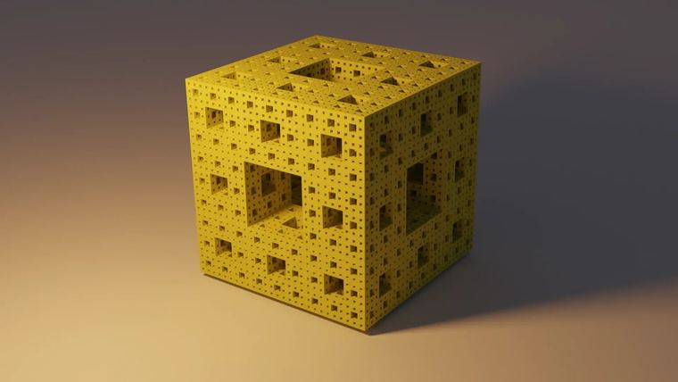

# 门格海绵

> 作者：**imhols**（UID 632698683） · 2023年10月7日 · 类型：`DYNAMIC_TYPE_DRAW` · [原动态](https://www.bilibili.com/opus/849776257526661140)

**WorldEdit / 程序化建模相关**

## 动态内容

门格海绵

//g 19 
n=4;
for(j=0,2){
if(j==1)swap(x,y);
if(j==2)swap(z,y);
X=0;Z=0;
for(i=1,n){
o=1/3^i;
if(max(abs(x-X),abs(z-Z))o)-(x-Xo)-(z-Z<-o);
X+=u*o*2;Z+=v*o*2
}
}
1


## 图片



## 指令

```text
//g 19
```

---

内容与图片版权归 **imhols** 所有；本页为作品集索引。
