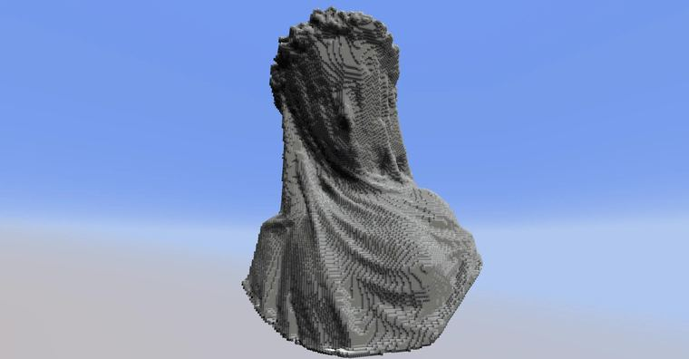
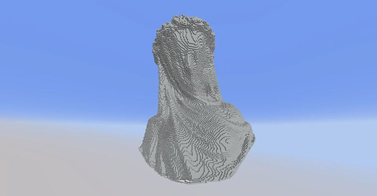

# 平行光源着色

> 作者：**imhols**（UID 632698683） · 2023年11月30日 · 类型：`DYNAMIC_TYPE_DRAW` · [原动态](https://www.bilibili.com/opus/869710991745613865)

**WorldEdit / 程序化建模相关**

## 动态内容

平行光源着色

abc是法向量的xyz的值，先设为0，利用3×3×3的范围，共有26个方向/组合，如果一方向是空气就在法向量上累加1，最后就能大致求表面一点的法向量，接着归一化，（这个计算法向量的办法绝了[热词系列_妙啊]）然后与设定的光线方向的向量点积求出两方向的夹角的余弦值cos(θ)（a·b=|a||b|*cos(θ)=1*1*cos(θ)）判断出两个向量的接近的程度，可以理解成光照强度，直射的就会更大，背离的就会越小，然后用这个余弦值进行上色。

(非原创，来源：https://discord.com/channels/804414667551670335/1178755403664851066 ）
在ta的基础上进行了改进：
能设置光源的角度，A：水平角度θ，B：仰角φ
n为调色板的长度，另外最后的x=y=z=后跟的是调色板的起始坐标，z+=是指沿着z轴正方向延申，见图三
避免了生成后实心变空心

注意：
1、模型不能是单层的/空心的，至少要有2到3层或者实心的
2、原模型的方块需要有数字id，防止we的query()检测不出该方块
3、下方指令已经超过了聊天栏的字符上限256，可以用命令方块加/sudo指令运行（服务器插件），你也可以把AB相关的删掉手动计算下面的v=...然后删点不必要的分号等等

/deform -r 
A=-5*pi/6;B=pi/3;n=16;
a=0;b=0;c=0;
if(queryAbs(x,y,z,0,0))return 0;
for(i=-1;i<2;i++)for(j=-1;j<2;j++)for(k=-1;k<2;k++){
if(queryAbs(x+i,y+j,z+k,0,0)){a+=i;b+=j;c+=k}}
d=sqrt(a*a+b*b+c*c);
if(d==0)return 0;
a/=d;b/=d;c/=d;
v=cos(B)*cos(A)*a+sin(B)*b+cos(B)*sin(A)*c;
x=-136;y=81;z=381;
z+=(v+1)/2*(n-1)

## 图片

---

内容与图片版权归 **imhols** 所有；本页为作品集索引。
