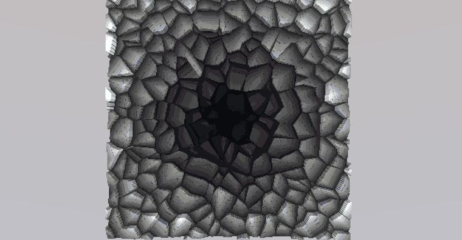
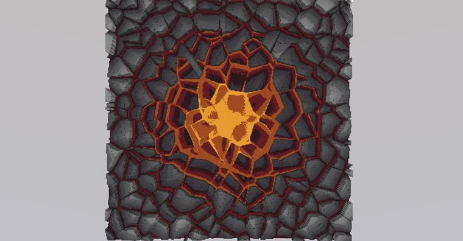
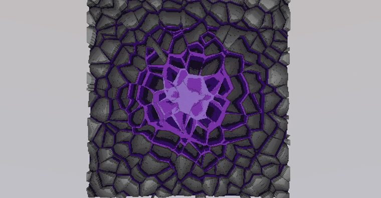
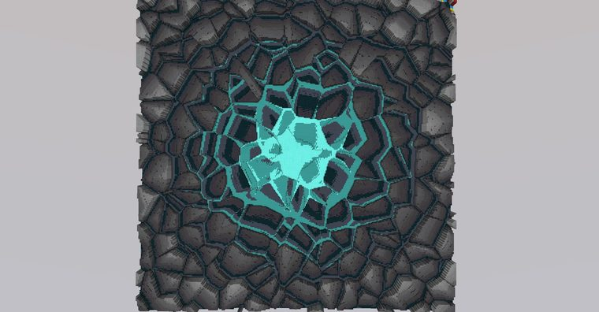
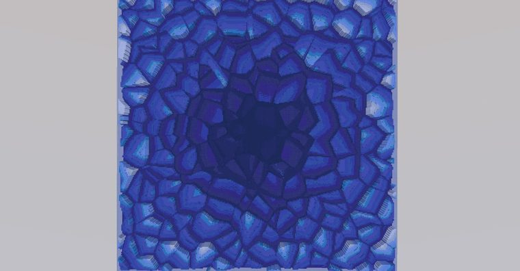

# 崩裂

> 作者：**imhols**（UID 632698683） · 2024年3月7日 · 类型：`DYNAMIC_TYPE_DRAW` · [原动态](https://www.bilibili.com/opus/906133547071307785)

**WorldEdit / 程序化建模相关**

## 动态内容

崩裂

//g 251 s=1;f=7;r=sqrt(x^2+z^2);a=x/r;b=z/r;for(d=0;1;d+=.01){if(voronoi(s,x,1,z,f)!=voronoi(s,x+d*a,1,z+d*b,f))break};data=min(d*min(r,1)*60+r*2,15);y+1<d*min(r,1)*6+r;


## 图片











## 指令

```text
//g 251 s=1;f=7;r=sqrt(x^2+z^2);a=x/r;b=z/r;for(d=0;1;d+=.01){if(voronoi(s,x,1,z,f)!=voronoi(s,x+d*a,1,z+d*b,f))break};data=min(d*min(r,1)*60+r*2,15);y+1<d*min(r,1)*6+r;
```

---

内容与图片版权归 **imhols** 所有；本页为作品集索引。
