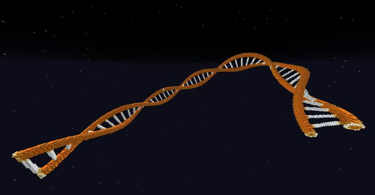

# DNA

> 作者：**imhols**（UID 632698683） · 2024年7月11日 · 类型：`DYNAMIC_TYPE_DRAW` · [原动态](https://www.bilibili.com/opus/952579332012769285)

## 动态内容

DNA

ezedits初体验

//ezspline expression 1 20 2 sqrt((abs(z)-0.7)^2+y^2)<0.2||sqrt((x%0.5)^2+y^2)<0.1&&abs(z)<0.7 

//eztexture ambient 1 ##GlowOrange 

插件地址：https://ezedits.gitbook.io/ezedits

## 图片

---

内容与图片版权归 **imhols** 所有；本页为作品集索引。
