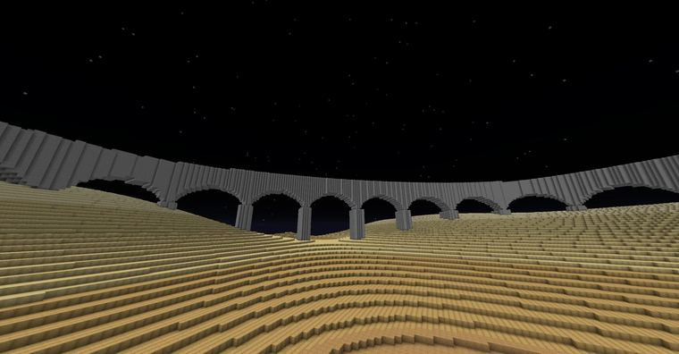

# 拱桥

> 作者：**imhols**（UID 632698683） · 2024年7月14日 · 类型：`DYNAMIC_TYPE_DRAW` · [原动态](https://www.bilibili.com/opus/953716553493250053)

## 动态内容

拱桥

//ezspline expression 1 20 -n UPRIGHT w1=0.3;w2=0.35;h1=1.5;h2=1;d=0.15;r=0.8;z-1+h1-r<-sqrt(r^2-((x+1)%(2*r)-r)^2)&&abs(y)<w1||abs((x+1+r)%(2*r)-r)<d&&1-z<h2&&abs(y)<w2

w1，w2 ：分别为拱门和桥墩的宽度（0 ~ 1）
h1，h2 ：分别为拱门开口和桥墩的高度（0 ~ 2）
d ：桥墩在另一个方向的宽度
r ：拱门的半径（它也控制间距）

插件：ezedits

## 图片

---

内容与图片版权归 **imhols** 所有；本页为作品集索引。
