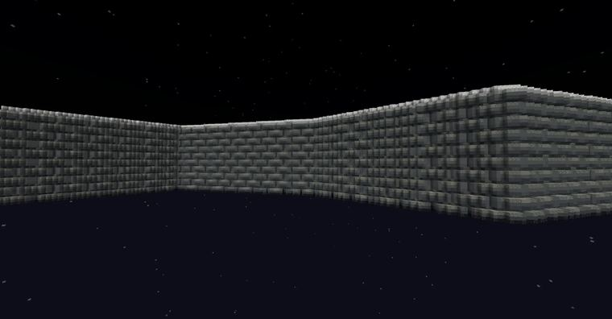
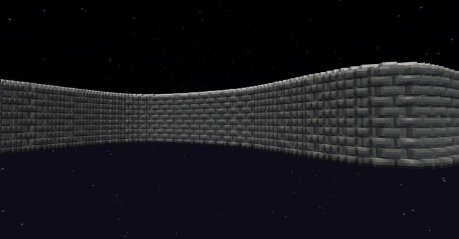

# 砖墙

> 作者：**imhols**（UID 632698683） · 2024年7月20日 · 类型：`DYNAMIC_TYPE_DRAW` · [原动态](https://www.bilibili.com/opus/956282049089503249)

## 动态内容

砖墙

//ezspline expression 1 20 -n UPRIGHT -p 0:0:-1 -q 3 w=0.2;s1=0.2;s2=0.4;d=0.05;t=0.08;abs(y)<w-t*((z%s1+s1)%s1<d||((x+floor(z/s1)*s2/2)%s2+s2)%s2<d)

//eztexture sunlight 1 ##Grayscale

w：墙宽
s1：行间距
s2：柱间距
d：砖缝宽度
t：砖缝深度 

插件：ezedits

## 图片

---

内容与图片版权归 **imhols** 所有；本页为作品集索引。
