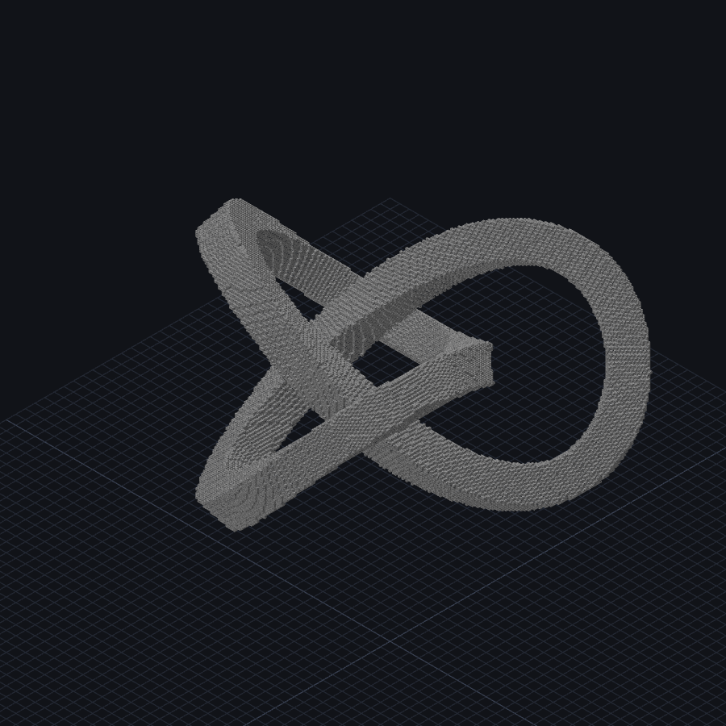

# 高级 `//gen`：128³ 艺术建模与 256³ 扩展

这篇文档把散落在官方手册、B 站教程、WesterosCraft/MathMod 公式和分形资料里的 `//gen` 用法，
整理成一套可复现的 128×128×128 建模流程。配套脚本在
[examples/advanced](../../examples/advanced/README.md)，每个脚本都以
`//pos1 0,0,0` / `//pos2 127,127,127` 开头，可直接在空投影上运行。


## 1. 先看 B 站：最系统的 `//gen` 讲解

B 站上大多数 WorldEdit 教程停在选区、复制、笔刷；真正把 `//gen` 讲透的是 LocusAzzurro 的
《创世神的 64 把木斧》系列：

- [#52 `//gen` 函数表达式生成 - 初识](https://www.bilibili.com/video/BV1nQ4y1r74M/)
  - 机制、基本用法、`-h` 空心、选区/坐标缩放；课后练习是 45° 平面和空心圆柱。
- [#53 `//gen` 函数表达式生成 - 进阶](https://www.bilibili.com/video/BV1AP4y1b7EN/)
  - 数学/比较/逻辑运算符、函数、实际坐标模式（`-r`）与逻辑组合；课后练习是抛物面和正方体。
- [入门总览（豹猫苦力怕可乐）](https://www.bilibili.com/video/BV1qu4y1N7i2/)
  - 适合补选区、笔刷、复制粘贴的基础。

B 站上“爱心/拱桥/龙卷风”的成品公式很少单独成系列，更多是建筑区视频里的片段或专栏截图；
所以本文把视频里的**方法**（坐标模式、逻辑组合、空心、选区缩放）和公开的数学曲面公式结合，
给出可运行的 128³ 版本。搜索时可用关键词：`WorldEdit //gen`、`创世神 函数生成`、
`WE 表达式 建筑`、`WorldEdit 分形`。

## 2. 128³ 工作流

### 2.1 建立画布

页面：`＋` → 文件名 → 勾选 **128 × 128 × 128 大型画布**（或 **256 × 256 × 256 超大画布**）→ 创建。
CLI/API 也可以直接建 128³（上限 256³）：

```text
//pos1 0,0,0
//pos2 127,127,127
//set air
```

建议一个脚本只做一个作品，文件名用 `作者_作品_128.schem`。脚本末尾写 `stop`，CLI 会自动保存。

### 2.2 坐标模式

| Flags | 坐标 | 适用 |
|---|---|---|
| 无 | `-1..1` 归一化 | 与选区比例绑定的抽象形状 |
| `-c` | 选区中心，1 方块=1 单位 | 以中心对称的球/环 |
| `-r` | 原始坐标，1 方块=1 单位 | **128³ 场景/建筑/分形（本文全部用这个）** |
| `-o` | 放置点为原点 | 以 pos1 为原点 |

128³ 中，`-r` 的坐标就是 0..127，公式里用 `x-63.5` 把中心移到 63.5，最直观。

### 2.3 一次生成，分层上色

`//gen` 一次只能给一个 pattern；直接写多种颜色会变成随机混合，不适合艺术模型。推荐：

```text
//gen -r white_concrete <形状>          # 白色占位
//gmask white_concrete                 # 只改占位块
//replace =y<40 blue_concrete          # 按坐标分区上色
//replace =y>=40&&y<80 cyan_concrete
//gmask                                # 关闭全局蒙版
//replace white_concrete gold_block    # 剩余白色 → 主色
```

- `//gmask` 是全局蒙版，和 `//replace` 的 mask 取交集；这样不会把空气也填成颜色。
- **`//replace` 的表达式 mask 不能含空格**。`=y>40 && y<80` 会被命令解析器拆成多个参数；
  必须写成 `=y>40&&y<80`。`//gen` 的表达式可以含空格，因为它是 `<expression...>` 可变参数。
- 同一坐标带不要重叠；先上色再上第二层会覆盖。需要渐变就多写几条窄带，或按角度/半径分区。
- 需要“撒糖针/星星”时，可在上色后用 `//gen` 追加，或 `//gmask <颜色>` 后用
  `//replace =random()<... <颜色>`。

### 2.4 空心与厚度

- `-h` 只放“邻接非形状方块”的壳；适合球、穹顶、分形。
- 自定义厚度用两个同形状条件相减，例如球壳：
  `r<40 && r>37`。
- 隧道/管道用 `d<外半径 && d>内半径`，不依赖 `-h`，厚度可控。

### 2.5 表达式与循环

WorldEdit 7.4 的表达式支持 `while`/`for`/`if`、赋值、`sin/cos/atan2/sqrt/ln/exp`、
`perlin/voronoi/ridgedmulti`、`rotate/swap`。循环最多 256 次。

`//gen` 的表达式按方块求值，最后一个值 >0 就放置。常用写法：

```text
# 先算变量，最后给条件
r=sqrt((x-63.5)^2+(z-63.5)^2);
a=atan2(z-63.5,x-63.5);
r<40&&abs(sin(a*5))<0.2
```

分形用 `while`；注意变量名不要和 `x/y/z` 冲突，且循环后要保留初始坐标用于范围裁剪：

```text
a=(x-63.5)/40; b=(y-63.5)/40; c=(z-63.5)/40;
ox=a; oy=b; oz=c;
...
inside&&abs(ox)<=1&&abs(oy)<=1&&abs(oz)<=1
```

## 3. 18 个 128³ 配方 + 256³ 扩展

脚本都在 [examples/advanced](../../examples/advanced/README.md)。下表是核心思路，完整命令
（含配色/底座）以脚本为准。

| # | 作品 | 核心公式/方法 | 脚本 |
|---|---|---|---|
| 01 | 鎏金心 | 心形隐式曲面 + `//gmask` 金色裂纹 + 黑石底座 | `01_heart_128.txt` |
| 02 | 三拱桥 | 圆拱环 + 高桥墩 + 水面/河岸 + 栏杆/灯 | `02_arch_bridge_128.txt` |
| 03 | 甜甜圈 | 环面 `(sqrt(dx²+dz²)-R)²+dy²<=r²`；糖霜波浪边界 + 彩色糖针 + 盘子 | `03_donut_128.txt` |
| 04 | 嵌套魔方 | 3×3 魔方面板 + 黑框 + 金色角块 + 切角露出内层紫/品红/发光核心 | `04_rubik_128.txt` |
| 05 | 肋拱隧道 | 弯曲中心线的圆管壳 + 深色肋 + 铁轨/枕木 + 尽头黑曜石门 | `05_ribbed_tunnel_128.txt` |
| 06 | 龙卷风 v3 | 平滑双曲线旋转涡管 + 尘柱；白模后用 `tools/colorize_y.py` 做分位/Voronoi/玻璃层色映射 | `06_tornado_128.txt` |
| 07 | 雨纹曼陀罗 | 同心圆 + 正三角形/正五边形轮廓 + 五重花瓣 + 金色外圈 | `07_rain_mandala_128.txt` |
| 08 | 六边形蜂巢 | 轴向六边形距离 + 蜂窝壁 + 蜂蜜背板 + 金边 | `08_hex_honeycomb_128.txt` |
| 09 | 洋葱头穹顶 | 旋转洋葱轮廓 + 金色穹顶/棱线 + 鼓座 + 十字 | `09_onion_dome_128.txt` |
| 10 | 麦田 | Perlin 地形 + 分层土/草 + 麦子行 + 小路/篱笆/草垛 | `10_wheat_field_128.txt` |
| 11 | 六边形玄武岩柱 | 六边形柱 + 噪声柱高 + 苔藓顶 + 熔岩缝 | `11_basalt_columns_128.txt` |
| 12 | 海螺 | 半径/管径随高度增长的螺旋管 + 壳口外翻 + 珍珠色带 | `12_conch_shell_128.txt` |
| 13 | 曼德尔布罗特 | 逃逸时间 + 2D 集合挤出 + 黑背板/金框 | `13_mandelbrot_128.txt` |
| 14 | 曼德尔球 | 8 次幂 Mandelbulb 逃逸时间 + 空心壳 + 分层色 | `14_mandelbulb_128.txt` |
| 15 | 门格尔海绵 | 4 级三分挖空 + 三色高度带 + 底座 | `15_menger_128.txt` |
| 16 | 曼德尔箱 | box fold + sphere fold + scale -1.8 + 逃逸时间 | `16_mandelbox_128.txt` |
| 17 | 莫比乌斯带 | 半扭转带宽方程 `|u sin(θ/2)-v cos(θ/2)|<t` + 角度配色/发光边 | `17_mobius_128.txt` |
| 18 | 银河 v2 | 平面旋转椭圆玻璃臂 + Voronoi 块 + 黑球/金环 + 双曲喷流 + `closest` 辐条 + 稀疏星场 | `18_galaxy_128.txt` |

## 4. 关键公式

### 4.1 心形

标准 3D 心形隐式曲面（`u` 水平，`v` 前后，`w` 上下）：

```text
u=(x-63.5)/38; v=(z-63.5)/38; w=(y-58)/38;
(u^2+2.25*v^2+w^2-1)^3-u^2*w^3-(9/80)*v^2*w^3<=0
```

`w` 用 `y`，所以心是竖着的。128³ 下 `38` 约等于半宽；想胖一点调大分母，想瘦调小。
金色裂纹用两个相交的正弦平面，在 `//gmask white_concrete` 下替换成金块：

```text
//replace =abs((x-64)+9*sin((y-20)/7))<0.9 gold_block
```

### 4.2 环面/甜甜圈

```text
(sqrt((x-63.5)^2+(z-63.5)^2)-40)^2+(y-64)^2<=17^2
```

`40` 是环心半径，`17` 是管半径。糖霜边界不是水平面，而是：

```text
y>64-6*abs(sin(atan2(z-63.5,x-63.5)*6))
```

这样糖霜会沿圆周起伏，形成滴落。糖针用 `random()` 在 `//gmask pink_concrete` 下替换。

### 4.3 莫比乌斯带

```text
dx=x-63.5; dz=z-63.5; dy=y-63.5;
r=sqrt(dx^2+dz^2); th=atan2(dz,dx);
u=r-36;
s=abs(u*sin(th/2)-dy*cos(th/2));
tt=sqrt(u^2+dy^2);
s<2.2&&tt<18
```

`s` 是到“半扭转带面”的近似距离，`tt` 限制带宽。这个公式在 64³ 就能看出莫比乌斯扭转，
128³ 边缘更干净。按 `atan2` 分象限上色，再沿 `s` 的边界加发光边。

### 4.4 曼德尔球

8 次幂版本：

```text
a=(x-63.5)/40; b=(y-63.5)/40; c=(z-63.5)/40;
ox=a; oy=b; oz=c; i=0;
while(i<9&&a*a+b*b+c*c<4){
  rr=sqrt(a*a+b*b+c*c); rr=max(rr,0.00001);
  th=acos(max(-1,min(1,c/rr))); ph=atan2(b,a);
  rp=rr^8; th=th*8; ph=ph*8;
  a=rp*sin(th)*cos(ph)+ox;
  b=rp*sin(th)*sin(ph)+oy;
  c=rp*cos(th)+oz;
  i++;
};
i>=9
```

加 `-h` 变成壳；128³、9 次迭代约 24 秒。颜色按 `y` 分带；不要用太多种颜色，否则像糖果。
`-h` + `//gmask` 上色比逐色重算快得多。

### 4.5 门格尔海绵

```text
a=(x-63.5)/40; b=(y-63.5)/40; c=(z-63.5)/40;
ox=a; oy=b; oz=c; inside=1; i=0;
while(i<4&&inside){
  ax=abs(a); ay=abs(b); az=abs(c);
  dx=ax>1/3&&ax<2/3;
  dy=ay>1/3&&ay<2/3;
  dz=az>1/3&&az<2/3;
  if(dx+dy+dz>=2){inside=0;};
  a=3*a-2*(a>1/3?1:(a<-1/3?-1:0));
  b=3*b-2*(b>1/3?1:(b<-1/3?-1:0));
  c=3*c-2*(c>1/3?1:(c<-1/3?-1:0));
  i++;
};
inside&&abs(ox)<=1&&abs(oy)<=1&&abs(oz)<=1
```

最后四个 `abs(ox)<=1...` 很重要：没有它，选区外也会被填，看起来像实心方块。
4 级在 80³ 域内约 10 万块；用浅色方块才看得见孔洞，黑色会“糊成实心”。

### 4.6 六边形蜂巢

把 `x/y` 映射到轴向六边形坐标：

```text
q=(0.577350269*(x-63.5)-0.333333333*(y-63.5))/9;
r=(0.666666667*(y-63.5))/9;
dq=q-round(q); dr=r-round(r);
hd=(abs(dq)+abs(dr)+abs(dq+dr))/2;
hd>=0.42&&hd<0.52
```

`hd` 是到最近六边形中心的距离；`0.5` 是边界。取 `0.42..0.52` 做蜂窝壁，内部留空，
后面再铺蜂蜜色背板。`z` 方向挤出 24 格形成厚度。

### 4.7 银河

平面螺旋臂用 XZ 平面内的长椭圆，椭圆本身随半径旋转：

```text
dx=x-63.5; dz=z-63.5; dy=y-64;
r=sqrt(dx*dx+dz*dz);
u=dx; v=dz; rot=0.10*r+0.35; rotate(u,v,rot);
w=8+0.09*r;
warp=v+1.4*perlin(4,u*0.04,y*0.06,v*0.04,0.05,2,0.5);
arm=(u/54)^2+(warp/w)^2<1;
n=voronoi(3,u,y,v,0.08);
arm&&r>8&&r<56&&abs(dy)<2.5+0.5*sin(r*0.28)&&n>0.32
```

- `rotate(a,b,angle)` 只接受**两个变量并原地改写**，不是 3D 位置函数。XZ 平面旋转要写
  `u=dx; v=dz; rotate(u,v,angle)`；`sqrt(dx²+dz²)` 用来控制螺旋扭转角（这里是 `0.10*r`），
  不能直接当作 `rotate` 的坐标参数。
- `u/54` 是长轴，`w` 是长椭圆半短轴；`warp` 用 Perlin 轻微扭动臂缘。
- `voronoi(3,u,y,v,0.08)` 的频率约对应 12 格大块，配合 `n>0.32` 把臂撕成块，但不会碎成
  单方块噪点。颜色用 `//gmask light_blue_stained_glass` + `//replace` 按半径分青/蓝/紫，
  再撒少量粉玻璃和发光方块，避免把空气也替换掉。
- 黑球用 `dx²+dz²+dy²<4.8²`，外面是金块环 + 橙色/黄色玻璃吸积盘。
- 类星体喷流用绕 Y 轴旋转的双曲线：`rr=dx²+dz²; h=abs(dy); h*rr≈K`。
  近中心 `r` 小，`h` 大；远处 `h` 落回银盘。外壳用
  `abs(h*rr-K)<(0.45+0.035*r)*rr`，`K` 加 Perlin 扰动，玻璃分三层。
- 小臂辐条按参考公式先生成 12 个圆周顶点，再用 `closest` 比较偏移点生成 Voronoi 边：
  `A=closest(p+d,0,q,...); B=closest(p-d,...); A!=B`。整体先
  `rotate(p,q,0.045*r+0.3)`，再叠加 Perlin，最后只保留 `r=8..48` 的薄层。
- 星场是覆盖银河的大椭球，`random()<0.0016*(1-R)^1.5+0.00015`，
  越靠近中心概率越高，但总量保持在 1k 以内；全部用萤石。

## 5. 复杂地形

### 5.1 麦田

```text
h=8+9*perlin(7,x,0,z,0.035,4,0.5)+3*sin(x/9)*cos(z/11)
```

- 先 `y<h-4` 石头，再 `y>=h-4&&y<h-1` 土，`y>=h-1&&y<=h` 草。
- 麦子：`y>h&&y<h+2&&(x%5<1)`，pattern 用 `wheat[age=7]`。
- 小路、篱笆、草垛用单独的 `//gen`，不要试图在一个表达式里做所有材质。

### 5.2 六边形玄武岩柱

在蜂巢的 `hd` 基础上，给每个六边形单元一个高度：

```text
hash=sin(round(q)*12.9898+round(r)*78.233)*43758.5453;
hash=hash-floor(hash);
top=8+18*perlin(9,x,0,z,0.035,4,0.5)+8*hash;
hd<0.44&&y<top
```

柱顶用 `smooth_basalt`，部分柱顶用 `moss_block`，柱缝在低处填 `magma_block`。
玄武岩柱的“六边形”来自 `hd`，高度变化来自 `perlin + hash`，两者缺一不可。

## 6. 128³ 的美术与性能

### 构图

- **不要把一个 40 格大的物体扔进 128³ 空场**。用底座、水面、云层、树或灯光把画面撑满；
  或者像 `01/03/04` 一样做“展品 + 底座”。
- 主色不超过 3 个，辅色 2–3 个；分形/地形用同色系高度带，不要彩虹条。
- 大形状靠**负空间**：空心、切角、拱洞、蜂窝孔。实心大块最容易显得低质。
- 加一件“人类尺度”参照物：桥上的灯、麦田的草垛、龙卷风旁的树/房子。

### 性能

- 128³ 选区 = 2,097,152 次表达式求值；简单球体约 3–10 秒，Mandelbulb 约 24 秒，
  Mandelbox 10 次迭代约 40–80 秒。CLI 超时已提到 600 秒。
- 方块数 20–30 万仍可交互；60 万（Mandelbox）会关闭方块点选，但渲染仍可看。
- 大模型优先用 `-h`/壳/薄片；不要生成实心 128³。
- 颜色分层用 `//gmask`，不要为每种颜色重算分形。
- 页面端超过 25 万块会跳过隐形的点选网格，避免内存翻倍；需要点选时用更小的版本。

## 7. 常见错误

1. `//replace` mask 里写空格：`=y>40 && y<80` → 解析成多个参数；改成 `=y>40&&y<80`。
2. 忘记 `//pos1/2`：`//gen` 报“请先建立一个选区”。
3. `-r` 写成默认模式：坐标变成 `-1..1`，`x-63.5` 永远不满足，生成 0 块。
4. Menger 不裁剪 `ox/oy/oz`：选区外也被填，变成实心方块。
5. 用黑色展示 Menger/Mandelbrot：黑洞看不出来；用浅灰/白/金。
6. 分形循环变量和 `x/y/z` 重名：覆盖输入坐标，形状错乱。
7. 先上色再想加第二种颜色，但 `//gmask` 还停留在旧颜色：记得 `//gmask` 关闭或切换。
8. 把 60 万块模型直接塞进旧浏览器标签：先刷新页面，再等 `[render]` 指标出现。

## 8. 视角、截图与作品集

页面右上角现在有一组工程视角：

- **等轴测**：正交投影，方向 `(1,1,1)`，方位角 45°、极角 54.7356°。
- **前/后/左/右**：正交立面。
- **顶/底**：正交平面；顶视图自动把 up 设为 `(0,0,-1)`，避免相机万向锁。

取景使用**实际方块包围盒**，不是 128³ 选区：计算 8 个角点投影到相机的 right/up 轴，
再按画布宽高比设置正交视锥，留 8% 边距。所以作品会刚好占满画面，而不是缩在空选区中间。
“等轴测”按钮和下拉框都会重新自动取景。

“截图”只截 3D canvas（不含侧栏/命令面板），并把机位写入同名 JSON：

```
work/shots/<model>_<view>_<timestamp>.png
work/shots/<model>_<view>_<timestamp>.json
```

JSON 含 `position`、`target`、`up`、`direction`、`azimuthDeg`、`polarDeg`、`zoom`、正交
视锥和模型 bounds。完整作品集见 [docs/portfolio](../../docs/portfolio/README.md)：18 张等轴测图
+ 六边形蜂巢的四视图对比 + `manifest.json`；每张图都链接回本目录的生成脚本。

## 9. 白模 + Y 轴颜色曲线（新工具）

龙卷风的最终版本不再把所有颜色写死在一个 `//gen` 表达式里，而是：

1. `examples/advanced/06_tornado_128.txt` 只生成白模；
2. `tools/colorize_y.py` 读取白模，统计每个 Y 层的非空气方块数；
3. 用**累计分位** `q(y)` 而不是裸 `y` 来分配颜色，避免上宽下窄的漏斗顶部因为面积大而吃掉大部分白色；
4. 在调色板相邻颜色间用 Bayer 有序抖动，边界叠加低频扰动，避免硬水平带；
5. 可选 `tornado_glass_layers`：上半段使用白色/淡蓝/青色/蓝色玻璃，下半段保持不透明灰/白，形成透明层次；
6. 输出完整彩色 `.schem`、颜色 overlay，并可通过 `--send` 上传到本地模拟器。

```bat
python tools\colorize_y.py work\advanced\tornado_white128.schem ^
  --palette tornado_glass_layers --send --name tornado_colored
```

128³ 的 `//paste` 剪贴板在 CLI 中不稳定，脚本的 `--send` 走 `/api/upload` 加载完整结果；overlay 仍保留给手动/小尺寸流程。

## 10. 256³ 三叶草结（imhols）

256³ 有 16,777,216 个格子，直接对每个格子求一次 `//gen` 表达式会很慢；这个例子改用
`tools/make_trefoil.py` 在 Python 里完成扫掠，再写出 Sponge `.schem`。它复现 imhols
的 Trefoil Knot Lua 脚本，并修正了正方形截面的朝向。

### 10.1 曲线

```text
S = scale; k = n-1
hx = S*(cos(t) + 2*cos(k*t))
hy = 2*S*a*sin(n*t)
hz = S*(sin(t) - 2*sin(k*t))
```

`n=3`、`a=0.5` 是参考图使用的三叶结投影。曲线绕 Y 轴旋转 `rotation` 度后放进
256³ 画布中心。

### 10.2 扫掠正方形

每个采样段取切线 `T`，再取横截面两个轴 `N/B`，把正方形沿 `T` 平移：

```text
P(t+dt)-P(t) -> T
R' = N*cos(twist) + B*sin(twist)
U' = B*cos(twist) - N*sin(twist)
|lx|<=thickness && |ly|<=thickness && -0.5<=lz<=seg_len+0.5
```

- 默认 `--frame frenet`：`N` 来自曲线曲率法线，正方形会随 3D 走线旋转。
- `--frame parallel`：平行传输，尽量少扭转。
- `--frame projected`：保留 Lua 原来的固定上方向框，适合对照原脚本；它会让一个
  截面轴一直保持水平，所以看起来“正方形没转”。

注意 `lz` 的上界是**整段长度** `seg_len`，不是 `dt*seg_len`；把这段写错会在每段
只填一小片，管子会断成点。

### 10.3 生成

```bat
python tools\make_trefoil.py --out schematics\portfolio_19_trefoil_256.schem ^
  --frame frenet --rotation 75
```

默认 `scale=30`、`thickness=8`、`step=0.04`、`n=3`、`a=0.5`、`material=stone`；
输出约 221k 方块，`bounds` 180×80×179，生成约 1 秒。256³ 空白状态的 JSON 约 20MB，
所以页面的 256³ 选项只用于建模/查看，不建议对每个格子跑大规模 `//gen`。



## 11. 资料与延伸

### B 站

- [创世神的 64 把木斧 #52 - `//gen` 初识](https://www.bilibili.com/video/BV1nQ4y1r74M/)
- [创世神的 64 把木斧 #53 - `//gen` 进阶](https://www.bilibili.com/video/BV1AP4y1b7EN/)
- [WorldEdit 入门总览](https://www.bilibili.com/video/BV1qu4y1N7i2/)
- [WorldEdit & FAWE 指令杂谈（mask/pattern、`//deform rotate`）](https://www.bilibili.com/read/cv20869663/)

### 官方与公式库

- <https://worldedit.enginehub.org/en/latest/usage/generation/>
- <https://worldedit.enginehub.org/en/latest/usage/other/expressions/>
- <https://worldedit.enginehub.org/en/latest/commands/>
- <https://premiumminecraft.com/world-edits-shape-generation-math-formulas-how-to-list/>
  （桥、龙卷风、花瓶、双螺旋等公式合集；本文在其基础上重写为 128³/CLI 版本）
- <https://forum.westeroscraft.com/threads/terra-school-commands.3204/>
  （WesterosCraft Terra School 地形命令）
- MathMod / K3DSurf：官方推荐的参数曲面/隐式曲面实验工具
- Mandelbulber Manual：Mandelbulb / Mandelbox / Menger 的迭代定义
- <https://users.csc.calpoly.edu/~zwood/teaching/csc471/final13/kdanie03/>
  （Mandelbulb、Mandelbox、Menger 的入门解释）

> 公式本身是数学；教程视频/文章的表达与截图有版权。本文只做方法归纳和重新实现，
> 不复制视频内容。发布作品时请保留对公式来源/教程作者的致谢。
